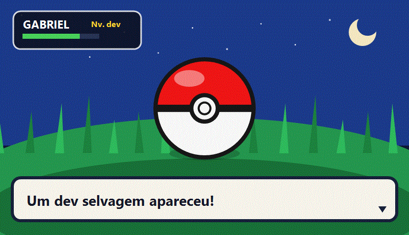

# Gabriel
**Desenvolvedor em treinamento** · Santo André, SP

Um dev selvagem apareceu. 
Estudo, construo ferramentas e deixo o Windows no ponto para jogar.

[LinkedIn](https://www.linkedin.com/in/devggoncalves/)

---

## Ficha do treinador

| | |
| --- | --- |
| **ID** | `devggoncalves` |
| **Classe** | Dev em treinamento |
| **Região** | Santo André, SP |
| **Tipo** | Aço · Elétrico |
| **Golpe** | Otimizar o PC e continuar estudando |

## Time

| Projeto | Stack | O que é |
| --- | --- | --- |
| **[MITFPS](https://devggoncalves.github.io/mitfps-download/)** | C# · WPF | Otimizador de Windows e jogos |
| **[Jurisly](https://github.com/devggoncalves/Projeto-Jurisly)** | Python · Django | Plataforma web para advogados e escritórios |
| **[Tutoriais](https://github.com/devggoncalves/Tutoriais-)** | PL/SQL · JS | Oracle APEX, Ajax, Jasper e exemplos práticos |

## Insígnias

`C#` `WPF` `Python` `Django` `HTML` `JavaScript` `Oracle APEX` `PL/SQL` `Docker`

## Registro

Conta pessoal de estudos. No público estão o otimizador de desempenho, o SaaS jurídico e as anotações de banco e interface.

Ilustração original, inspirada na franquia. Sem afiliação com a Nintendo, a Game Freak ou a The Pokémon Company.
